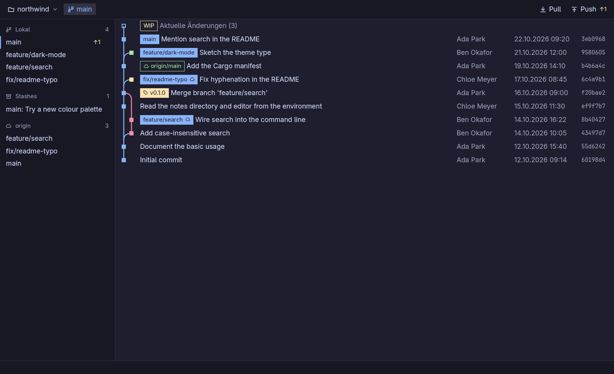
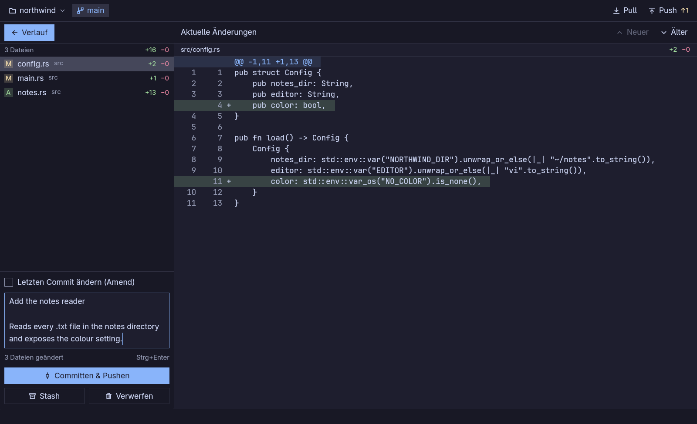
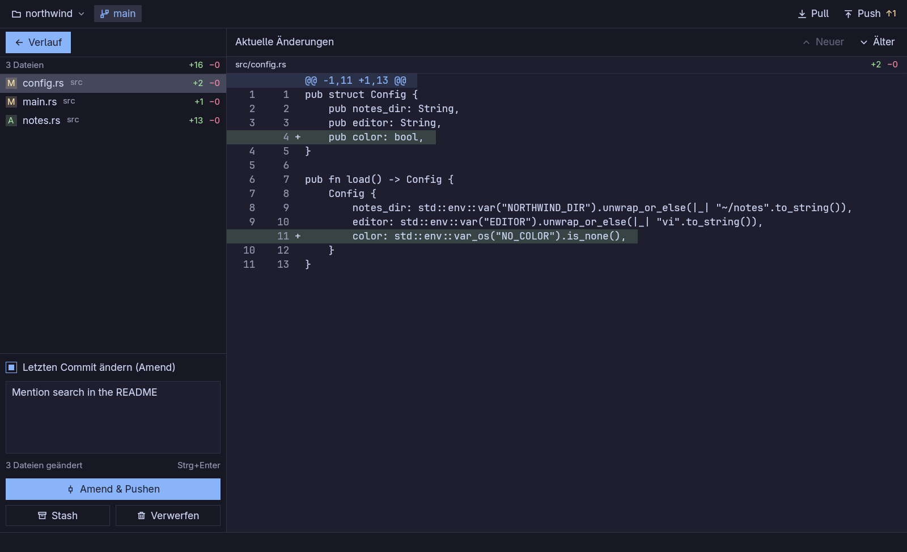
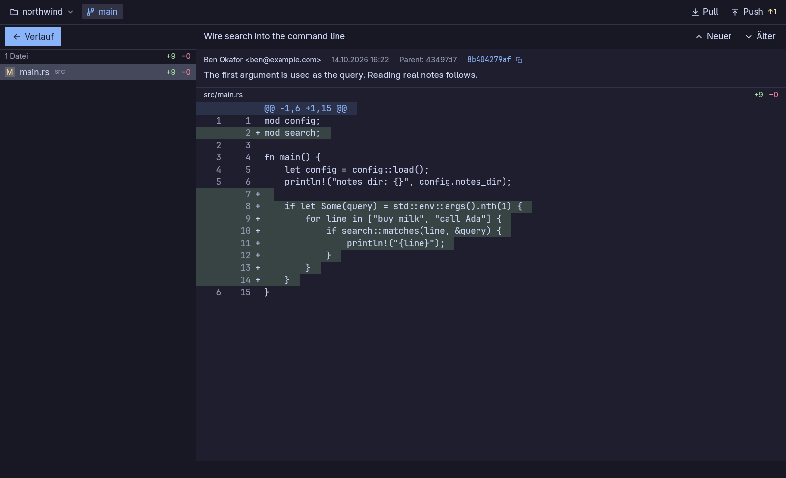
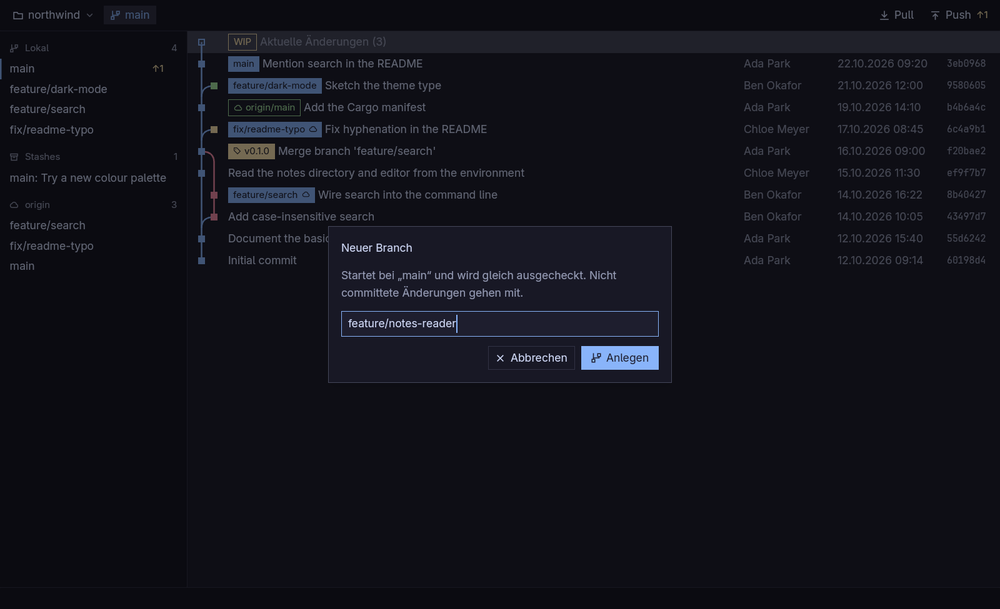

<p align="center">
  
</p>

<h1 align="center">GitBro</h1>

<p align="center">
  A slim, fast Git client — <strong>built with and for <a href="https://omarchy.org">Omarchy</a></strong>.<br>
  See the whole graph, then commit and push in a single step.
</p>

<p align="center">
  <a href="README.de.md">Deutsch</a> · <a href="LICENSE">0BSD license</a>
</p>



GitBro is a native desktop Git client written in Rust with [gpui](https://www.gpui.rs) (the UI framework behind Zed).
It was made explicitly **for Omarchy and Hyprland**: it follows your Omarchy theme live, uses your Omarchy mono font in diffs,
starts instantly, and is meant to feel like part of the desktop rather than a heavyweight IDE plugin.

It is deliberately opinionated. Git has a lot of ceremony; GitBro folds the everyday path into as few steps as possible:

> **Select the WIP row → write a message → _Commit & Push_.**

No staging area to manage, no separate push step.

> **Note:** the user interface is currently in German. Translations are welcome.

## Features

- **The whole picture** — a graph of every branch, remote branch, tag and stash, with ahead/behind counts. Uncommitted changes show up as a **WIP** row at the top.
- **One-step commit** — everything that changed (new files included) is committed and pushed right away. The first push of a new branch sets the upstream automatically. Repositories without a remote simply commit.
- **Amend** — tick _Letzten Commit ändern_ and the last message is pre-filled. If that commit is already on the remote, the button turns yellow and says so: the push then uses `--force-with-lease`, so it never overwrites work someone else pushed.
- **Discard everything** — one button, always with a confirmation. Resets tracked files, removes untracked ones, and ends an unfinished merge. Ignored files are left alone.
- **Stash** — stash including untracked files with an optional name; apply, pop or drop from the sidebar.
- **Branches** — create one from the ⋯ menu of the current branch, double-click to check out, merge or delete from the ⋯ menu. Deleting tells you how many commits exist _only_ on that branch before it throws them away.
- **Safe Pull** — fetches everything, prunes, and fast-forwards. It never creates a surprise merge commit or conflict; if histories diverged it tells you instead.
- **Full-screen diff** — changed-files list, line numbers, binary detection, and _Neuer_/_Älter_ to walk through history.
- **Handy details** — recent repositories (`Ctrl+R`), the last repo opens automatically, a plain folder can be turned into a repository with one click (default branch `main`), and the view refreshes when the window regains focus.

| Commit & push in one step | Amend the last commit |
| --- | --- |
|  |  |

| Browse a commit | New branch |
| --- | --- |
|  |  |

## Omarchy integration

- **Live theme** — colours come from the active Omarchy theme (`~/.local/state/omarchy/current/theme/colors.toml`). Switch themes and GitBro repaints within a second, no restart. Without Omarchy it falls back to Catppuccin Mocha.
- **Fonts** — diffs use the font reported by `omarchy font current`.
- **Hyprland-friendly** — Wayland-native, with a proper app id (`gitbro`), icon and `.desktop` entry, so it shows up in your launcher and window rules work.
- **Angular, flat design** — square corners and thin borders to match the Omarchy look.

## Install

You need a Rust toolchain ([rustup](https://rustup.rs) or [mise](https://mise.jdx.dev), which Omarchy ships) and `git` on your `PATH`.

```bash
git clone https://github.com/pixelriot/GitBro.git
cd GitBro
./install.sh
```

The script builds a release binary and installs it for the current user:

- `~/.local/bin/gitbro`
- icons under `~/.local/share/icons/hicolor/`
- `~/.local/share/applications/gitbro.desktop`

It is safe to re-run for updates, even while GitBro is open. Then start it from your launcher, or run `gitbro [path-to-repo]`.

To only try it: `cargo run --release -- /path/to/repo`.

## Keys

| Key | Action |
| --- | --- |
| `↑` / `↓` | Move through commits (or changed files in a diff) |
| `Enter` | Open the selected commit / confirm a dialog |
| `Esc` | Close dialog or menu, then the diff |
| `Ctrl+Enter` | Commit & push from the message field |
| `Ctrl+R` | Recent repositories |
| `Ctrl+O` | Open a repository |

## How it works

- **Reading** uses [libgit2](https://libgit2.org) via the `git2` crate, which keeps the graph and diffs fast on big repositories.
- **Writing** (commit, push, stash, checkout, merge, …) runs the real `git` command. Your SSH agent, credential helpers, hooks and filters such as Git LFS behave exactly as they do in the terminal, and GitBro never invents its own Git semantics.
- Git is run non-interactively: it never prompts on a terminal and never opens an editor, so a missing credential becomes an error message instead of a hang.

## Status

GitBro is young and built for one person's daily workflow first. It does what is listed above and deliberately leaves out a lot: no rebase, cherry-pick, submodule UI or hunk-level staging, and **no merge-conflict resolution UI yet** (a conflicted merge can be aborted from the toolbar, and committing is blocked until conflicts are resolved elsewhere).
Ideas and pull requests are welcome.

## Development

```bash
cargo run -- /path/to/repo   # debug build (dependencies are optimised, so it stays fast)
cargo test                   # git behaviour is tested against real temporary repositories
```

## License

[0BSD](LICENSE) — do whatever you want with it, no attribution required.

Written together with [Claude Code](https://claude.com/claude-code).
